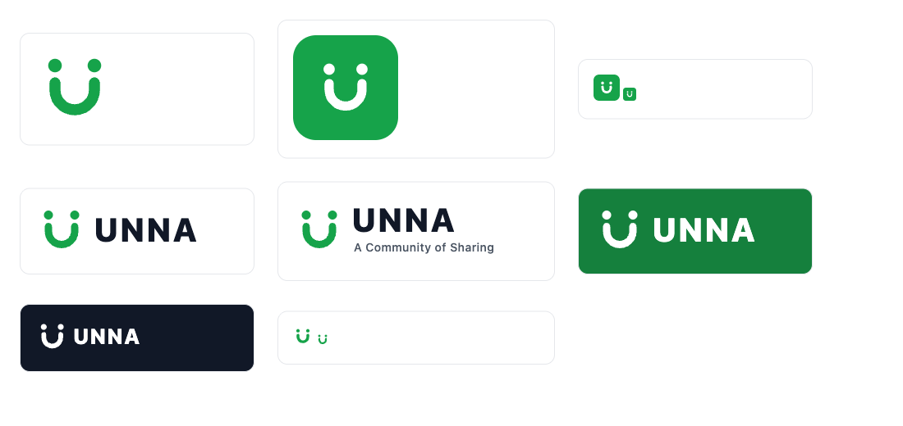

# Manual de marca UNNA

UNNA es la plataforma para gestionar un restaurante entero: ventas, cobros, carta, stock y delivery en un solo lugar. Este manual define cómo se ve y cómo habla la marca, para que la app, la web y cualquier pieza comunicacional se reconozcan como una sola cosa.

## Resumen rápido

| Si necesitás… | Usá |
|---|---|
| El logo en fondo claro | [`unna-logo-horizontal.svg`](assets/unna-logo-horizontal.svg) |
| El logo en fondo verde u oscuro | [`unna-logo-negative.svg`](assets/unna-logo-negative.svg) |
| El ícono de la app, favicon o redes | [`unna-app-icon.svg`](assets/unna-app-icon.svg) |
| Solo el símbolo (espacios chicos) | [`unna-symbol.svg`](assets/unna-symbol.svg) |
| Logo con lema (presentaciones, landing) | [`unna-logo-tagline.svg`](assets/unna-logo-tagline.svg) |
| El verde de marca en una superficie o ícono | `#16a34a` (`unna-green`) |
| Verde con texto encima o texto verde | `#15803d` (`unna-green-dark`) |
| La tipografía | Inter |

## 1. Esencia

| | |
|---|---|
| **Qué somos** | Todo tu restaurante. Una sola plataforma. |
| **Lema de comunidad** | A Community of Sharing — compartir conocimiento, recursos y crecimiento hace que todos ganemos. |
| **Para quién** | Dueños y equipos de restaurantes, bares, cafés y locales gastronómicos de Latinoamérica. |
| **Promesa** | Menos tiempo en el sistema, más tiempo en el salón. |

**Personalidad**

- **Cercana:** hablamos como alguien del rubro, no como un banco.
- **Clara:** cada pantalla y cada mensaje dicen qué pasó y qué hacer.
- **Confiable:** manejamos la plata del cliente; nada de ambigüedad con montos ni estados.
- **Generosa:** la marca comparte; ayuda, explica y celebra los logros del negocio.

## 2. Logo

### Símbolo

Dos personas (los puntos) cuyos brazos forman un bowl compartido. El bowl dibuja la **U** de UNNA y, a la vez, una sonrisa: hospitalidad y comunidad alrededor de la comida.

| Pieza | Archivo | Uso |
|---|---|---|
| Símbolo | `assets/unna-symbol.svg` | Favicon de pestaña, avatares, sellos, espacios menores a 120 px de ancho |
| Logo horizontal | `assets/unna-logo-horizontal.svg` | Header de la web y la app, documentos, mails |
| Logo con lema | `assets/unna-logo-tagline.svg` | Landing, presentaciones, piezas institucionales |
| Logo negativo | `assets/unna-logo-negative.svg` | Fondos `#15803d`, `#14532d` o `#111827` |
| Ícono de app | `assets/unna-app-icon.svg` | App, PWA, favicon, redes sociales |

### Construcción

- Grilla del símbolo: 64 × 64.
- Trazo del bowl: 9 unidades, extremos redondeados.
- Cabezas: círculos de radio 5,5 sobre los extremos del bowl.
- Wordmark: "UNNA" en Inter ExtraBold (800), espaciado +3, a la derecha del símbolo con una separación de 24 unidades.

> En los SVG el wordmark está como texto con `font-family: Inter`. Para imprenta o para usar el logo donde Inter no está instalada, convertí el texto a curvas en el archivo final.

### Área de resguardo y tamaño mínimo

- **Resguardo:** dejá alrededor del logo un espacio libre igual al diámetro de una cabeza (11/64 de la altura del símbolo). Nada de texto ni bordes dentro de esa zona.
- **Tamaño mínimo:**
  - Logo horizontal: 96 px de ancho en pantalla, 25 mm impreso.
  - Símbolo e ícono: 16 px (está probado a ese tamaño).

### Usos incorrectos

- No cambies los colores fuera de la paleta ni uses degradés.
- No estires, rotes ni inclines el logo.
- No pongas el logo verde sobre fondos verdes o fotos sin contraste: usá la versión negativa.
- No agregues sombras, contornos ni efectos.
- No separes las cabezas del bowl ni cambies sus proporciones.
- No reemplaces el wordmark por otra tipografía.

## 3. Color

| Token | Hex | RGB | Uso |
|---|---|---|---|
| `unna-green` | `#16a34a` | 22, 163, 74 | Color principal: símbolo, íconos, superficies destacadas, bordes de foco |
| `unna-green-dark` | `#15803d` | 21, 128, 61 | Botones y fondos **con texto**, texto verde, hover |
| `unna-green-light` | `#22c55e` | 34, 197, 94 | Acentos y estados positivos sobre fondos oscuros |
| `primary-900` | `#14532d` | 20, 83, 45 | Fondos oscuros de marca (footer, banners) |
| `unna-gray-dark` | `#374151` | 55, 65, 81 | Texto secundario fuerte |
| `unna-gray` | `#6b7280` | 107, 114, 128 | Texto de apoyo, ayudas |
| `unna-gray-light` | `#f3f4f6` | 243, 244, 246 | Fondos de sección, estados deshabilitados |
| Tinta | `#111827` | 17, 24, 39 | Títulos y texto principal |

**Proporción sugerida:** 70 % blancos y grises claros, 20 % tinta y grises, 10 % verde. El verde guía la atención; si todo es verde, nada se destaca.

### Contraste (WCAG 2.1)

Medido contra blanco. AA pide 4,5:1 para texto normal y 3:1 para texto grande (≥ 24 px, o ≥ 18,66 px en negrita) y elementos gráficos.

| Color | Sobre blanco | Texto normal | Texto grande / íconos |
|---|---|---|---|
| `#16a34a` | 3,30:1 | ❌ | ✅ |
| `#15803d` | 5,02:1 | ✅ | ✅ |
| `#22c55e` | 2,28:1 | ❌ | ❌ |
| `#14532d` | 9,11:1 | ✅ | ✅ |
| `#6b7280` | 4,83:1 | ✅ | ✅ |
| `#111827` | 17,74:1 | ✅ | ✅ |

**Regla práctica:** `#16a34a` para el símbolo, íconos y superficies sin texto. Si hay texto blanco encima o el texto es verde, usá `#15803d`.

> **Pendiente en la app:** `.btn-primary` (`apps/web/src/app/globals.css`) hoy usa texto blanco sobre `#16a34a` (3,30:1, no cumple AA para el tamaño del botón). Recomendado: fondo `#15803d` y hover `#14532d`.

## 4. Tipografía

**Inter** para todo (ya cargada en la web con `next/font`).

| Rol | Peso | Tamaño de referencia |
|---|---|---|
| Wordmark | ExtraBold 800 | — |
| Títulos (h1) | Bold 700 | 30–36 px |
| Subtítulos (h2–h3) | Semibold 600 | 18–24 px |
| Texto | Regular 400 | 16 px |
| Botones y etiquetas | Semibold 600 / Medium 500 | 14–16 px |
| Montos | Semibold 600, cifras tabulares (`font-variant-numeric: tabular-nums`) | según contexto |

Montos siempre en formato argentino: `$ 1.500,00` (punto para miles, coma para decimales).

## 5. Voz y tono

Español rioplatense, con **voseo**, directo y amable. Hablamos del negocio del cliente, no de nosotros.

| Hacemos | Evitamos |
|---|---|
| "Cargá categorías, productos, modificadores y stock." | "El usuario deberá proceder a cargar…" |
| "El pedido tiene pagos registrados; corresponde un reembolso, no una cancelación." | "Error 400: operación inválida." |
| "Ingresá un precio válido en pesos (por ejemplo 1.500 o 1500,50)." | "Formato numérico incorrecto." |
| "¡Bienvenido a UNNA!" | Mayúsculas sostenidas, signos múltiples (¡¡¡!!!) |

- **Errores:** qué pasó + qué hacer. Nunca culpar al usuario.
- **Montos y estados:** precisos. "Restante $ 1.132,90", no "falta un poco".
- **Inglés:** solo en el lema "A Community of Sharing" y en nombres técnicos que el rubro ya usa (POS, delivery).

## 6. Interfaz

| Elemento | Criterio |
|---|---|
| Bordes | Redondeados: `rounded-lg` en botones e inputs, `rounded-2xl` en tarjetas |
| Superficies | Blanco sobre `#f9fafb`/`#f3f4f6`; borde `#f3f4f6`–`#e5e7eb` |
| Botón primario | Verde con texto blanco (ver regla de contraste) |
| Botón secundario | Borde verde, texto verde oscuro, fondo blanco |
| Foco | Anillo de 2 px `#16a34a` con separación |
| Íconos | Trazo de 2 px, esquinas redondeadas, color heredado del texto |
| Estados | Éxito verde, error rojo `#dc2626`, aviso ámbar `#d97706`; siempre acompañados de texto, nunca solo color |

## 7. Aplicaciones

| Pieza | Archivo base | Notas |
|---|---|---|
| Favicon | `unna-app-icon.svg` | Exportar `favicon.ico` 16/32/48 px |
| Ícono PWA / app | `unna-app-icon.svg` | Exportar PNG 192 y 512 px; `apple-touch-icon` 180 px |
| Header web/app | `unna-logo-horizontal.svg` | Altura 32 px |
| Imagen para compartir (Open Graph) | `unna-logo-tagline.svg` sobre `#f3f4f6` | 1200 × 630 |
| Redes sociales (avatar) | `unna-app-icon.svg` | Recorte circular: el símbolo queda centrado con margen suficiente |

> **Pendiente en la app:** la web pide `/manifest.json` y `/favicon.ico` y hoy no existen (404). Con los íconos exportados de este manual se completan.

## Checklist antes de publicar una pieza

- [ ] Usa un archivo de `docs/brand/assets/`, sin modificar.
- [ ] Respeta el área de resguardo y el tamaño mínimo.
- [ ] El texto verde o sobre verde usa `#15803d`.
- [ ] La tipografía es Inter.
- [ ] Los textos están en rioplatense con voseo y los montos en formato `$ 1.500,00`.
- [ ] El contraste del texto es de al menos 4,5:1.
